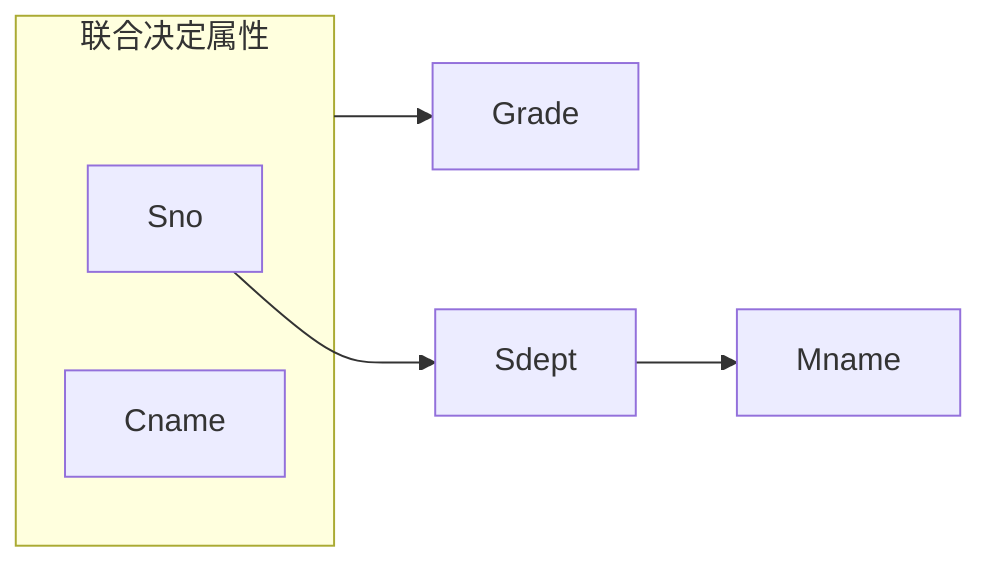
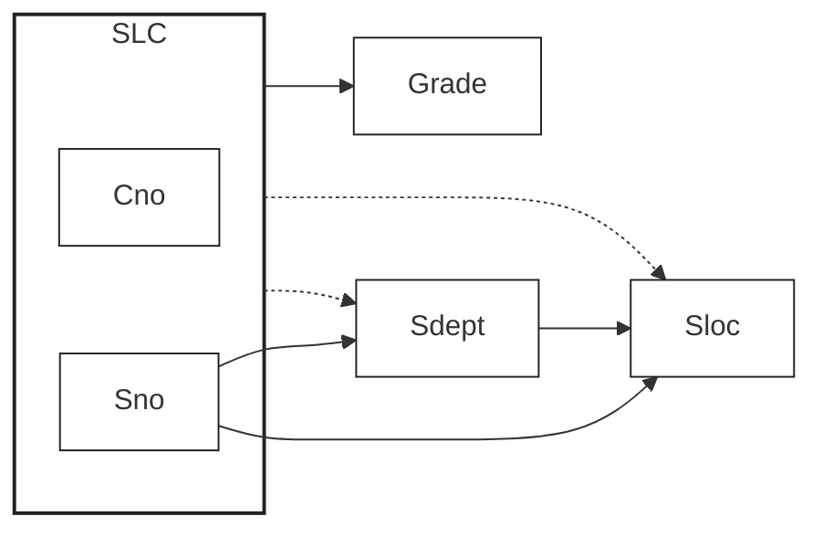
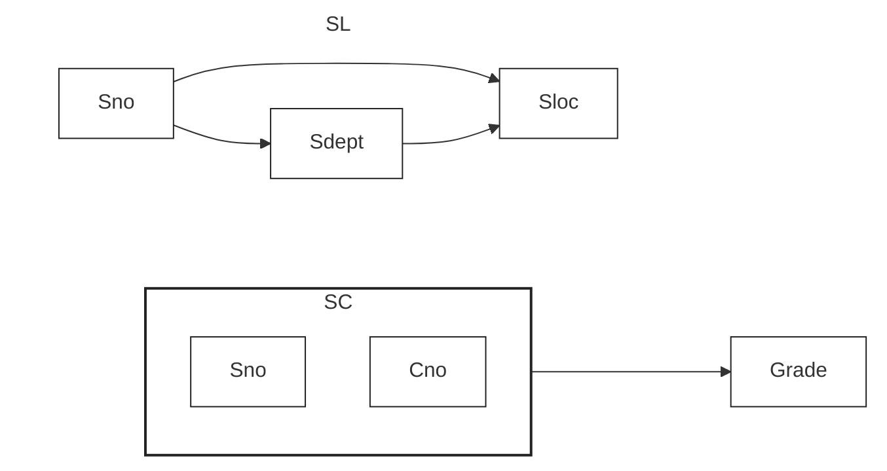
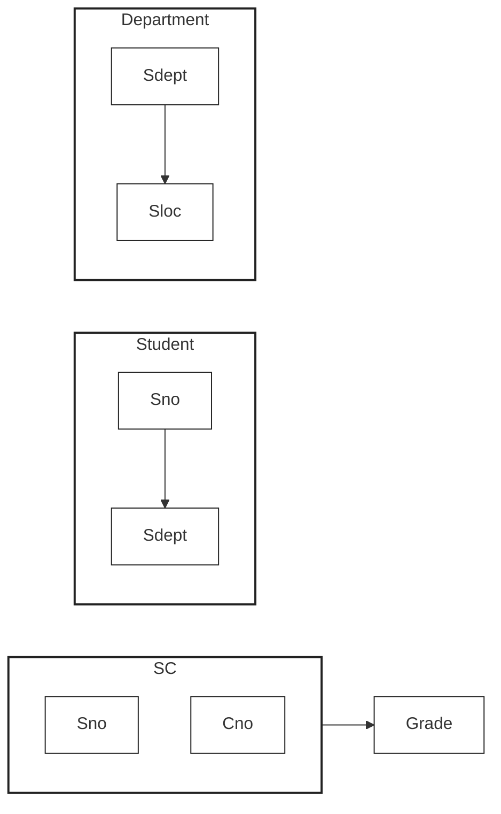
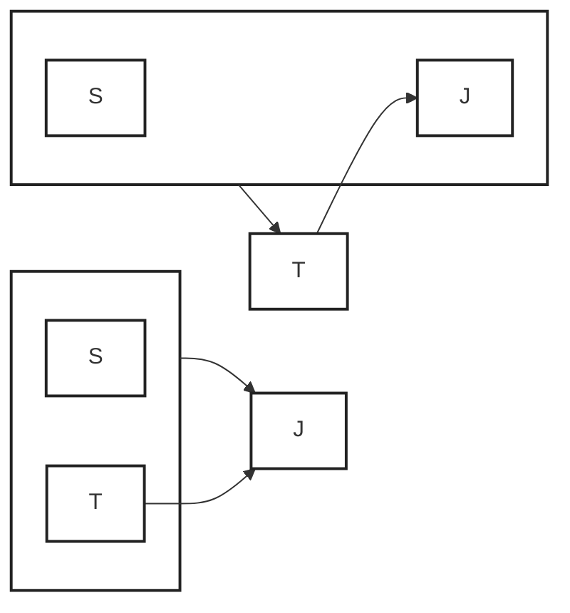
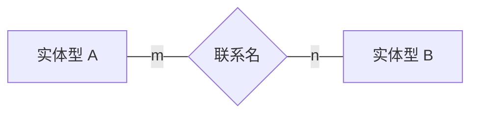

#
<!--more-->

# 1. 数据库系统概述
## 1.1 四个基本概念
- **数据**：描述事物的符号记录
- **数据库**（DB）：长期存储在计算机内的、有组织的、可共享的数据集合。
- **数据库管理系统**（DataBase Management System，DBMS）：是完成科学地组织和存储数据、高效获取和维护数据任务的，位于用户和操作系统之间的一层**数据管理软件**。
	- oracle，MySQL，SQL Server, PostgreSQL, DB2, Access
- **数据库系统**（DataBase System，DBS）：是指在计算机系统中引入数据库后的系统，由数据库、DBMS（及其开发工具）、应用系统、数据库管理员和用户构成。
## 1.2 数据模型
- 数据库按照数据结构来组织、存储和管理数据，实际上，数据库一共有三种模型： 层次模型 网状模型 关系模型
# 2. 关系数据库
- 在一个给定的应用领域中，所有实体及实体之间联系的关系的集合构成一个关系数据库。
## 2.1 关系数据结构及形式化定义
### 2.1.1 关系
- **域**（Domain）：一组具有相同数据类型的值的集合。
- **笛卡尔积**（Cartesian Product）：给定n个域，n层遍历，每个域取一个值构成一个元素，不能重复。
	- 元组：笛卡尔积中每一个元素叫作一个n元组或简称元组。
	- 分量：元组中的每一个值
	- 基数：笛卡尔积的元素个数
- **关系**（Relation）：笛卡尔积的子集叫作在域D1，D2，…，Dn上的关系
	- n是关系的度
	- 关系也是一个二维表，表的每行对应一个元组，表的每列对应一个域。
	- **属性**：关系中不同列可以对应相同的域，为了加以区分，必须对每列起一个名字，称为属性（Attribute）。n目关系必有n个属性。
	- 码：若关系中的某一属性组的值能唯一地标识一个元组，则称该属性组为**候选码**，在最简单的情况下，候选码只包含一个属性。称为全码（All-key）
### 2.1.2 关系模式
- 什么是关系模式：对关系的描述
- 定义关系模式：R（U，D，dom，F）
	- R：关系名
	- U：组成该关系的属性名集合
	- D ：属性组U中属性所来自的域
	- dom：属性向域的映象集合
	- F ：属性间的数据依赖关系集合
- 关系模式与关系
	- 关系模式是对关系的描述，是静态的、稳定的
	- 关系是关系模式在某一时刻的状态或内容动态的、随时间不断变化的
### 2.1.3 关系数据库
- 在一个给定的应用领域中，所有实体及实体之间联系的关系的集合构成一个关系数据库。
- **关系数据库的型**称为关系数据库模式，是对关系数据库的描述若干域的定义在这些域上定义的若干关系模式
- **关系数据库的值**是这些关系模式在某一时刻对应的关系的集合，通常简称为关系数据库

## 2.2  关系操作
### 2.2.1 基本的关系操作
- **查询**：选择、投影、连接、除、并、交、差
- **数据更新**：插入、删除、修改
### 2.2.2 关系操作的特点
- 集合操作方式，即操作的对象和结果都是集合。
## 2.3  关系的完整性
- 完整性规则是给定的数据模型中的数据及其联系所具有的制约和依存规则，用以限定符合数据模型的数据库状态以及状态的变化，以保证数据的正确、有效、相容。
	- **实体完整性**：主码不能取空值
	- **参照完整性**：外码只能空或者等于参考关系中的主码值
	- **用户定义的完整性**：针对某一具体关系数据库的约束条件，反映某一具体应用所涉及的数据必须满足的语义要求。例如学分只能取1，2，3
- 实体完整性和参照完整性是关系模型必须满足的完整性约束条件，被称作是关系的两个不变性，应该由关系系统自动支持。

## 2.4  关系代数
- 一种抽象的查询语言，用对关系的运算来表达查询
- 关系代数运算的三个要素
	- 运算对象：关系
	- 运算结果：关系
	- 运算符：四类
### 2.4.1 运算符

| 类别       | 运算符         | 含义     | 解释                                                                            |
| -------- | ----------- | ------ | ----------------------------------------------------------------------------- |
| 集合运算符    | $$\cup$$    | 并      |                                                                               |
|          | $$-$$       | 差      | R - S：n由属于R而不属于S的所有元                                                          |
|          | $$\cap$$    | 交      |                                                                               |
|          | $$\times$$  | 广义笛卡尔积 | R×S：元组的前n列是关系R的一个元组后，m列是关系S的一个元组                                              |
| 比较运算符    | $$>$$       | 大于     |                                                                               |
|          | $$\geq$$    | 大于等于   |                                                                               |
|          | $$<$$       | 小于     |                                                                               |
|          | $$\leq$$    | 小于等于   |                                                                               |
|          | $$=$$       | 等于     |                                                                               |
|          | $$\neq$$    | 不等于    |                                                                               |
| 专门的关系运算符 | $$\sigma$$  | 选择     | 在关系R中选择满足给定条件的诸元组，选出符合条件的行                                                    |
|          | $$\pi$$     | 投影     | 从R中选择出若干属性列组成n新的关系，选出符合条件的列                                                   |
|          | $$\bowtie$$ | 连接     | 从两个关系的笛卡尔积中选取属性间满足一定条件的元组，例如$R \underset{C<E}{\bowtie} S$ 表示从笛卡尔积中取出C列小于E列的结果 |
|          | $$\div$$    | 除      |                                                                               |
| 逻辑运算符    | $$\neg$$    | 非      |                                                                               |
|          | $$\land$$   | 与      |                                                                               |
|          | $$\lor$$    | 或      |                                                                               |
#### 1）符号表示
- 关系模式为R(A1，A2，…，An)则：
	- 它的一个关系设为R。
	- $t \in R$表示t是R的一个元组
	- $t[A_i]$ 表示元组t中相应于属性Ai的一个分量
	- t[A]=(t[Ai1]，t[Ai2]，…，t[Aik])表示元组t在属性列A上诸分量的集合
	- $\overset{\frown}{t_r t_s}$ ：R为n目关系，S为m目关系，从这两个关系中分别取出一个元组**连接**起来构成一个n + m列的元组，前n个分量为R中的一个n元组，后m个分量为S中的一个m元组。
	- 象集$Z_x$ : R中属性组X上值为x的诸元组在Z上分量的集合。
#### 2）运算符
##### 连接
- 等值连接，判断条件为两列值相等
- 自然连接：两个关系中进行比较的分量必须是相同的属性组，在结果中把重复的属性列去掉
- 外连接：把舍弃的元组也保存在结果关系中（比如自然连接中R的C列有一个取值1，S的C列有一个取值2，这两个是在自然连接时没有等于的，原本会被舍弃，这里就会保留，缺失的地方为NULL，这个例子里面就会多出来两行）
- 左外连接：值保留左侧要舍弃的元素
##### 除
给定关系R (X，Y) 和S (Y，Z)，其中X，Y，Z为属性组。R与S的除运算得到一个新的关系P(X)，P是R中满足下列条件的元组在X属性列上的投影：元组在X上分量值x的象集Yx包含S在Y上投影的集合。
- 举例：
假设R：

| A     | B     | C     |
| ----- | ----- | ----- |
| $a_1$ | $b_1$ | $c_2$ |
| $a_2$ | $b_3$ | $c_7$ |
| $a_3$ | $b_4$ | $c_6$ |
| $a_1$ | $b_2$ | $c_3$ |
| $a_4$ | $b_6$ | $c_6$ |
| $a_2$ | $b_2$ | $c_3$ |
| $a_1$ | $b_2$ | $c_1$ |
假设S

| B     | C     | D     |
| ----- | ----- | ----- |
| $b_1$ | $c_2$ | $d_1$ |
| $b_2$ | $c_1$ | $d_1$ |
| $b_2$ | $c_3$ | $d_2$ |
运算过程：
在关系R中，A可以取四个值{a1，a2，a3，a4}
    a1的象集为 {(b1，c2)，(b2，c3)，(b2，c1)}
　a2的象集为 {(b3，c7)，(b2，c3)}
　a3的象集为 {(b4，c6)}
　a4的象集为 {(b6，c6)}
S在(B，C)上的投影为
        {(b1，c2)，(b2，c1)，(b2，c3) }
只有a1的象集包含了S在(B，C)属性组上的投影
所以     R÷S =

| A     |
| ----- |
| $a_1$ |

# 3. SQL
## 3.1 SQL概述
- SQL语言的动词

| 功能        | 动词                     | 备注                                              |     |
| --------- | ---------------------- | ----------------------------------------------- | --- |
| 数据定义（DDL） | CREATE, DROP, ALTER    | 允许用户定义数据，也就是创建表、删除表、修改表结构这些操作。操作对象是**表，视图，索引**  |     |
| 数据查询（DQL) | SELECT                 |                                                 |     |
| 数据操纵（DML) | INSERT, UPDATE, DELETE | 为用户提供添加、删除、更新数据的能力，这些是应用程序对数据库的日常操作。操作对象是**数据** |     |
| 数据控制（DCL） | GRANT, REVOKE          |                                                 |     |

## 3.2 数据定义（DDL）
### 3.2.1 创建（CREATE）
- 允许用户定义数据，也就是创建表、删除表、修改表结构这些操作。通常，DDL由数据库管 理员执行。

| 操作对象 | 操作方式         |            |             | 备注  |
| ---- | ------------ | ---------- | ----------- | --- |
| 操作对象 | 创建           | 删除         | 修改          |     |
| 表    | CREATE TABLE | DROP TABLE | ALTER TABLE | 模式  |
| 视图   | CREATE VIEW  | DROP VIEW  |             | 外模式 |
| 索引   | CREATE INDEX | DROP INDEX |             |     |
- sql支持关系数据库三级模式结构：
	- 模式 ：基本表
	- 外模式：部分基本表和视图
	- 内模式 ：存储文件
- 视图：
	- 从一个或几个基本表导出的表
	- 数据库中只存放视图的定义而不存放视图对应的数据
	- 视图是一个虚表
	- 用户可以在视图上再定义视图

#### 1）创建数据库与角色
- 数据库对象命名机制：
	- 一个关系数据库管理系统的实例（Instance）中可以建立多个**数据库**
	- 一个数据库中可以建立多个**模式**
	- 一个模式下通常包括多个**表、视图和索引**等数据库对象
> PostgreSQL为例
```sql
-- 1. 删除之前的 test 数据库
DROP DATABASE IF EXISTS test WITH (FORCE);

-- 2. 创建 test 用户（如果不存在）
DO $$
BEGIN
    IF NOT EXISTS (
        SELECT 1 FROM pg_roles WHERE rolname = 'test'
    ) THEN
        CREATE USER test;
    END IF;
END $$;

-- 3. 设置 test 用户的登录密码
ALTER USER test WITH LOGIN PASSWORD '123456';

-- 4. 简单创建数据库
CREATE DATABASE test OWNER test;
-- 5. 删除数据库
DROP DATABASE test;

-- 6. 细粒度创建数据库
CREATE DATABASE test
WITH
    OWNER = test                -- 数据库所有者为 test
    TEMPLATE = template0       -- 使用干净的模板
    ENCODING = 'UTF8'          -- 字符编码
    TABLESPACE = pg_default    -- 默认表空间
    CONNECTION LIMIT = 20      -- 最大普通连接数
    ALLOW_CONNECTIONS = true;  -- 允许连接

-- 7. 测试数据库是否创建成功
SELECT datname, pg_get_userbyid(datdba) AS owner
FROM pg_database
WHERE datname = 'test';
```

启动方式（创建数据库的时候需要先连接一个已有的数据库）：
```shell
docker exec -i supermew-postgres \
  psql -U postgres -d postgres -v ON_ERROR_STOP=1 \
  < 1_createdatabase.sql
```
含义：

| 参数                   | 作用                   |
| -------------------- | -------------------- |
| `docker exec -i`     | 在运行中的 Docker 容器内执行命令 |
| `supermew-postgres`  | PostgreSQL 容器名称      |
| `psql`               | PostgreSQL 命令行客户端    |
| `-U postgres`        | 使用 `postgres` 用户登录   |
| `-d postgres`        | 连接已有的 `postgres` 数据库 |
| `-v ON_ERROR_STOP=1` | SQL 出错时停止执行          |


#### 2）模式的定义与删除
- 定义1：`CREATE SCHEMA <模式名> AUTHORIZATION <用户名>`
- 定义2：`CREATE SCHEMA <模式名> AUTHORIZATION <用户名> [<表定义子句>|<视图定义子句>|<授权定义子句>]`
- 删除：`DROP SCHEMA < 模式名> <CASCADE| RESTRICT>`
```sql
-- 1. 方式1： 单独创建模式
create schema "s-t"
    authorization test;

-- 2. 方式2： 创建模式的同时创建表
create schema test
    authorization test
    create table tab(
        col1 smallint, --短整型
        col2 int,
        clo3 char(20)
    );

-- 测试
select current_user, current_database(),
    to_regnamespace('"s-t"') as schema1,
    to_regclass('test.tab') as table_name
```
#### 3）基本表的定义
```
CREATE TABLE <表名>
      （<列名> <数据类型>[ <列级完整性约束条件> ]
      ，<列名> <数据类型>[ <列级完整性约束条件>] ] …
      [，<表级完整性约束条件> ] ）；
      
CREATE TABLE <"模式名".表名>
      （<列名> <数据类型>[ <列级完整性约束条件> ]
      ，<列名> <数据类型>[ <列级完整性约束条件>] ] …
      [，<表级完整性约束条件> ] ）；
```
- 常见数据类型：

| 数据类型      | 名称                             | 解释                               |
| --------- | ------------------------------ | -------------------------------- |
| 数字数据类型    | Bigint, int, smallint, tinyint | 8/4/2/1字节                        |
|           | Money                          |                                  |
|           | Decimal(p,s)/numeric(p,s)      | 定点数，由p位数字（不包括符号、小数点）组成，小数后面有d位数字 |
|           | Float(n)                       | 可选精度的浮点数，精度至少为n位数字               |
|           | real                           | 取决于机器精度的单精度浮点数                   |
| 字符数据类型    | char(n)                        | 长度为n的定长字符串                       |
|           | varchar(n)                     | 最大长度为n的变长字符串                     |
|           | text                           |                                  |
|           | nchar(n)                       |                                  |
|           | nvarchar(n)                    |                                  |
|           | ntext                          |                                  |
| 日期和时间数据类型 | Date                           | 日期，包含年、月、日，格式为YYYY-MM-DD         |
|           | Time                           | 时间，包含一日的时、分、秒，格式为HH:MM:SS        |
|           | Datetime2（有小数点）                |                                  |
|           | Datetime                       |                                  |
- 常见约束：
	- 主码约束：    PRIMARY  KEY
	- 唯一性约束：UNIQUE
	- 非空值约束：NOT NULL
	- 参照完整性约束
```sql
-- 1. 创建学生表 Student
CREATE TABLE test.Student (
    Sno   CHAR(9) PRIMARY KEY,  -- 学号，主键，长度为9
    Sname CHAR(20) UNIQUE,      -- 姓名，唯一约束
    Ssex  CHAR(2),              -- 性别
    Sage  SMALLINT,             -- 年龄，短整数
    Sdept CHAR(20)              -- 所在系
);


-- 2. 创建课程表 Course
CREATE TABLE test.Course (
    Cno     CHAR(4) PRIMARY KEY, -- 课程号，主键
    Cname   CHAR(40),            -- 课程名称
    Cpno    CHAR(4),             -- 先修课程号
    Ccredit SMALLINT,            -- 课程学分

    -- 外键约束：先修课程必须存在于 Course 表中
    -- 自引用外键：引用本表的 Cno
    FOREIGN KEY (Cpno) REFERENCES test.Course(Cno)
);


-- 3. 创建学生选课表 SC
CREATE TABLE test.SC (
    Sno   CHAR(9),               -- 学号，对应 Student.Sno
    Cno   CHAR(4),               -- 课程号，对应 Course.Cno
    Grade INT,                   -- 成绩

    -- 联合主键：一个学生不能重复选择同一门课程
    PRIMARY KEY (Sno, Cno),

    -- 外键约束：学号必须存在于学生表
    FOREIGN KEY (Sno) REFERENCES test.Student(Sno),

    -- 外键约束：课程号必须存在于课程表
    FOREIGN KEY (Cno) REFERENCES test.Course(Cno)
);


-- 4. 测试：查看创建的三张表
SELECT tablename
FROM pg_tables
WHERE schemaname = 'test'
  AND tablename IN ('student', 'course', 'sc');
```
#### 4）索引的定义
- 建立索引是为了加快查询速度。
- 关系数据库管理系统中常见索引：
	- 顺序文件上的索引
	- B+树索引：动态平衡的优点
	- 散列（hash）索引：查找速度快的特点
	- 位图索引
- 关系数据库管理系统自动选择合适的索引作为存取路径，用户不必也不能显式地选择索引
```
CREATE [UNIQUE] [CLUSTER] INDEX <索引名>
	ON <表名>(<列名>[<次序>][,<列名>[<次序>] ]…)；
```
- 用 **<表名>** 指定要建索引的基本表名字
- 索引可以建立在该表的一列或多列上，各列名之间用逗号分隔
- 用 **<次序>** 指定索引值的排列次序，升序：ASC，降序：DESC。缺省值：ASC
- **UNIQUE** 表明此索引的每一个索引值只对应唯一的数据记录，对于已含重复值的属性列不能建UNIQUE索引，相当于增加了一个UNIQUE约束
- **CLUSTER** 表示要建立的索引是聚簇索引，索引项的顺序和表中数据记录的物理顺序一致，建立聚簇索引后，基表中数据也需要按指定的聚簇属性值的升序或降序存放。因此在一个基本表上最多只能建立一个聚簇索引
```sql
-- 1. 创建唯一索引
-- Student 表：按学号升序建立唯一索引
CREATE UNIQUE INDEX Stusno
ON test.Student(Sno ASC);
-- Course 表：按课程号升序建立唯一索引
CREATE UNIQUE INDEX Coucno
ON test.Course(Cno ASC);
-- SC 表：按学号升序、课程号降序建立联合唯一索引
CREATE UNIQUE INDEX SCno
ON test.SC(Sno ASC, Cno DESC);


-- 2. 创建聚簇索引
-- 在 Student 表的姓名列上建立普通索引
CREATE INDEX Stusname
ON test.Student(Sname ASC);
-- PostgreSQL需要手动根据姓名索引对 Student 表进行物理重排
CLUSTER test.Student USING Stusname;


-- 3. 测试：查看创建的索引及其属性
SELECT
    i.relname AS index_name,
    t.relname AS table_name,
    x.indisunique AS is_unique,       -- 是否为唯一索引
    x.indisclustered AS is_clustered  -- 是否为聚簇标记索引
FROM pg_index x
JOIN pg_class i ON i.oid = x.indexrelid
JOIN pg_class t ON t.oid = x.indrelid
JOIN pg_namespace n ON n.oid = t.relnamespace
WHERE n.nspname = 'test'
  AND i.relname IN ('stusno', 'coucno', 'scno', 'stusname')
ORDER BY index_name;
```
### 3.2.2 修改（ALTER）
#### 1）修改基本表
- 修改列名和数据类型
```
ALTER TABLE <表名>
	[ ADD [COLUMN]<新列名> <数据类型> [ 完整性约束 ] ]
	[ ADD <表级 完整性约束>]
	[ DROP [COLUMN]<列名>[CASCADE|RESTRICT] ]
	[ DROP  CONSTRAINT  <完整性约束名> [CASCADE|RESTRICT] ]
	[ ALTER COLUMN <列名> <数据类型> ]；
```

```sql
-- 1. 向 Student 表增加入学时间列 Sentrance，日期类型
alter table test.Student
    add column Sentrance date;

-- 2. 删除 Sentrance 列，并将 Sage 修改为半字长整数
alter table test.Student
    drop column Sentrance,  --删除入学时间列
    alter column Sage type smallint;  -- 修改年龄的数据类型

-- 3. 测试：查看 Student 表的最终结构
SELECT column_name, data_type
FROM information_schema.columns
WHERE table_schema = 'test'
  AND table_name = 'student';
```
### 3.2.3 删除（DROP）
#### 1）删除基本表
- 删除后数据、表上的索引都删除，但表上的视图往往仍然保留，不过无法引用。
`DROP TABLE <表名> [RESTRICT|CASCADE];`
```sql
-- 1. 删除 Student 表
DROP TABLE test.Student CASCADE;

-- 2. 测试：检查 Student 表是否已删除
SELECT to_regclass('test.student') IS NULL AS deleted;
```
#### 2）删除索引
`DROP INDEX <索引名>；`
```sql
-- 1. 删除 Student 表的 Stusname 索引
DROP INDEX test.Stusname;

-- 2. 测试：检查索引是否已删除
SELECT to_regclass('test.stusname') IS NULL AS deleted;
```
## 3.3 数据查询（DQL)
```sql
SELECT [ALL|DISTINCT] <目标列表达式> [，<目标列表达式>] …
FROM <表名或视图名>[， <表名或视图名> ] …
[ WHERE <条件表达式> ]
[ GROUP BY <列名1> [ HAVING <条件表达式> ] ]
[ ORDER BY <列名2> [ ASC|DESC ] ]；
```
- SELECT子句：指定要显示的属性列
- FROM子句：指定查询对象(基本表或视图)
- WHERE子句：指定查询条件
 - GROUP BY子句：对查询结果按指定列的值分组，该属性列值相等的元组为一个组。通常会在每组中作用集函数。
- HAVING短语：筛选出只有满足指定条件的组
- ORDER BY子句：对查询结果表按指定列值的升序或降序排序 

### 3.3.1 单表查询
先准备一些样例数据：
```sql
-- 1. 创建学生表 Student
CREATE TABLE IF NOT EXISTS test.Student (
    Sno   CHAR(9) PRIMARY KEY,  -- 学号
    Sname CHAR(20) UNIQUE,      -- 姓名
    Ssex  CHAR(2),              -- 性别
    Sage  SMALLINT,             -- 年龄
    Sdept CHAR(20)              -- 所在系
);

-- 2. 创建课程表 Course
CREATE TABLE IF NOT EXISTS test.Course (
    Cno     CHAR(4) PRIMARY KEY, -- 课程号
    Cname   CHAR(40),            -- 课程名称
    Cpno    CHAR(4),             -- 先修课程号
    Ccredit SMALLINT,            -- 学分
    FOREIGN KEY (Cpno) REFERENCES test.Course(Cno)
);

-- 3. 创建选课表 SC
CREATE TABLE IF NOT EXISTS test.SC (
    Sno   CHAR(9),              -- 学号
    Cno   CHAR(4),              -- 课程号
    Grade INT,                  -- 成绩
    PRIMARY KEY (Sno, Cno),
    FOREIGN KEY (Sno) REFERENCES test.Student(Sno),
    FOREIGN KEY (Cno) REFERENCES test.Course(Cno)
);


-- 4. 向 Student 表插入学生信息
INSERT INTO test.Student (Sno, Sname, Ssex, Sage, Sdept)
VALUES
    ('202600001', '张三', '男', 20, 'CS'),
    ('202600002', '李四', '男', 21, 'CS'),
    ('202600003', '王五', '女', 19, 'MA'),
    ('202600004', '赵六', '女', 22, 'IS'),
    ('202600005', '陈七', '男', 20, 'IS'),
    ('202600006', '刘八', '女', 18, 'CS')
ON CONFLICT DO NOTHING;


-- 5. 向 Course 表插入课程信息
-- 按先修课依赖顺序插入
INSERT INTO test.Course (Cno, Cname, Cpno, Ccredit)
VALUES
    ('0001', '计算机导论', NULL, 2),
    ('0005', '高等数学', NULL, 4)
ON CONFLICT DO NOTHING;

INSERT INTO test.Course (Cno, Cname, Cpno, Ccredit)
VALUES
    ('0002', '数据结构', '0001', 4)
ON CONFLICT DO NOTHING;

INSERT INTO test.Course (Cno, Cname, Cpno, Ccredit)
VALUES
    ('0003', '数据库系统', '0002', 4),
    ('0004', '操作系统', '0002', 4)
ON CONFLICT DO NOTHING;


-- 6. 向 SC 表插入学生选课信息
INSERT INTO test.SC (Sno, Cno, Grade)
VALUES
    ('202600001', '0001', 90),
    ('202600001', '0002', 85),
    ('202600001', '0003', 92),
    ('202600002', '0001', 78),
    ('202600002', '0003', 88),
    ('202600003', '0005', 95),
    ('202600003', '0002', 82),
    ('202600004', '0003', 76),
    ('202600004', '0004', 85),
    ('202600005', '0004', 91),
    ('202600006', '0001', 87),
    ('202600006', '0005', NULL)
ON CONFLICT DO NOTHING;

INSERT INTO test.Course (Cno, Cname, Cpno, Ccredit)
VALUES ('0006', 'DB_Design', '0002', 3)
ON CONFLICT DO NOTHING;

-- 增加一个没有选修课程的学生
INSERT INTO test.Student (Sno, Sname, Ssex, Sage, Sdept)
VALUES ('202600007', '周九', '男', 23, 'MA')
ON CONFLICT DO NOTHING;

-- 增加一条选修2号课程且成绩超过90分的记录
INSERT INTO test.SC (Sno, Cno, Grade)
VALUES ('202600002', '0002', 95)
ON CONFLICT DO NOTHING;

-- 7. 测试：查看各表记录数量
SELECT 'Student' AS table_name, COUNT(*) FROM test.Student
UNION ALL
SELECT 'Course', COUNT(*) FROM test.Course
UNION ALL
SELECT 'SC', COUNT(*) FROM test.SC;
```
#### 1）选择表中的若干列
```sql
-- 1. 查询指定列
-- 查询全体学生的学号与姓名这两列
SELECT Sno, Sname
FROM test.Student;

-- 2. 查询全部列
SELECT *
FROM test.Student;

-- 3. 查询经过计算的值 
-- 查询全体学生的姓名及其出生年份（当前年份减去年龄）以及系名（小写）
select Sname, EXTRACT(YEAR FROM CURRENT_DATE)::INT - Sage, lower(Sdept)
from test.Student;

-- 4. 使用列别名
SELECT
    Sname,
    EXTRACT(YEAR FROM CURRENT_DATE)::INT - Sage AS BirthYear,
    lower(Sdept) AS DEPARTMENT
FROM test.Student;
```
#### 2）选择表中的若干元组
##### 1- 去重（DISTINCT）
```sql
-- 1. 不去重，可能出现重复学号
SELECT Sno
FROM test.SC;

-- 2. 使用 DISTINCT，去除重复学号
SELECT DISTINCT Sno
FROM test.SC;

-- 3. DISTINCT 作用于所有目标列，即 (Cno, Grade) 的组合
-- 查询选修课程的不同课程号与成绩组合
SELECT DISTINCT Cno, Grade
FROM test.SC;
```
##### 2- 查询满足条件的元组（WHERE）
常用的查询条件：

| 查询条件 | 谓词                                    |
| ---- | ------------------------------------- |
| 比较   | =、>、<、>=、<=、!=、<>、!>、!<、NOT + 上述比较运算符 |
| 确定范围 | BETWEEN AND、NOT BETWEEN AND           |
| 确定集合 | IN、NOT IN                             |
| 字符匹配 | LIKE、NOT LIKE                         |
| 空值   | IS NULL、IS NOT NULL                   |
| 多重条件 | AND、OR                                |
###### 比较大小
```sql
-- 查询所有年龄在20岁以下的学生姓名及其年龄。
select Sname, Sage
from test.Student
where Sage<20;

-- 等价写法：用not
select Sname, Sage
from test.Student
where not Sage>=20
```
###### 确定范围
- between and
```sql
-- 查询年龄在20~23岁（闭区间）之间的学生的姓名、系别和年龄。
select Sname, Sdept, Sage
from test.Student
where Sage between 20 and 22
```
###### 确定集合
- int, not in
```sql
-- 查询信息系(IS)、数学系(MA)和计算机系(CS)学生的姓名和性别
SELECT Sname, Ssex
FROM test.Student
WHERE Sdept IN ('IS', 'MA', 'CS');


-- 查询不是信息系(IS)、数学系(MA)学生的姓名和性别
SELECT Sname, Ssex
FROM test.Student
WHERE Sdept NOT IN ('IS', 'MA');
```
###### 字符匹配
- `[NOT] LIKE  ‘<匹配串>’  [ESCAPE ‘ <换码字符>’] <匹配串>：指定匹配模板`
	- `%` : 任意长度通配符
	- `_`: 单字符通配符
	- ESCAPE：指定转义字符
```sql
-- 1. 精确匹配
-- 查询学号为202600001的学生详细情况
SELECT *
FROM test.Student
WHERE Sno LIKE '202600001';
-- 等价写法
SELECT *
FROM test.Student
WHERE Sno = '202600001';


-- 2. 通配符，
-- 2.1 任意长度
-- 查询所有姓刘学生的姓名、学号和性别
SELECT Sname, Sno, Ssex
FROM test.Student
WHERE Sname LIKE '刘%';
-- 2.2 单字符
-- 查询姓张且姓名为两个汉字的学生
SELECT Sname
FROM test.Student
WHERE TRIM(Sname) LIKE '张_';
-- 2.3 组合使用
-- 查询姓名第二个字为“四”的学生姓名和学号
SELECT Sname, Sno
FROM test.Student
WHERE TRIM(Sname) LIKE '_四%';
-- 2.4 取反
-- 查询所有不姓刘的学生姓名
SELECT Sname
FROM test.Student
WHERE Sname NOT LIKE '刘%';


-- 3. escape
-- 询 DB_Design 课程的课程号和学分
-- 指定 ! 为转义字符
SELECT Cno, Ccredit
FROM test.Course
WHERE Cname LIKE 'DB!_Design' ESCAPE '!';
-- 查询以 DB_ 开头，且倒数第3个字符为 i 的课程
SELECT *
FROM test.Course
WHERE Cname LIKE 'DB!_%i__' ESCAPE '!';
```
###### 空值查询
```sql
-- 1. 查询选修课程但没有考试成绩的学生学号和课程号
SELECT Sno, Cno
FROM test.SC
WHERE Grade IS NULL;

-- 2. 询所有有考试成绩的学生学号和课程号
SELECT Sno, Cno
FROM test.SC
WHERE Grade IS NOT NULL;
```
###### 多重条件查询
```sql
-- 1. and
SELECT Sname
FROM test.Student
WHERE Sdept = 'CS' AND Sage < 20;

-- 2. or
SELECT Sname, Ssex
FROM test.Student
WHERE Sdept = 'IS'
   OR Sdept = 'MA'
   OR Sdept = 'CS';
```
#### 3）对查询结果排序（ORDER BY）
```sql
-- 1. 查询选修了0003号课程的学生学号及成绩
-- 查询结果按照成绩降序排列
SELECT Sno, Grade
FROM test.SC
WHERE Cno = '0003'
ORDER BY Grade DESC;

-- 2. 查询全体学生的详细情况
-- 先按照所在系升序排列; 同一系内的学生再按照年龄降序排列
SELECT *
FROM test.Student
ORDER BY Sdept ASC, Sage DESC;
```

#### 4）使用聚集函数

| 函数                          | 解释  |
| --------------------------- | --- |
| COUNT（[DISTINCT\|ALL] <列名>） | 计数  |
| SUM（[DISTINCT\|ALL] <列名>）   | 求和  |
| AVG（[DISTINCT\|ALL] <列名>）   | 平均  |
| MAX（[DISTINCT\|ALL] <列名>）   | 最大值 |
- DISTINCT：在计算时要取消指定列中的重复值
- ALL短语：不取消重复值（默认）
```sql
-- 1. 计数
-- 查询学生总人数
SELECT COUNT(*) AS StudentCount
FROM test.Student;

-- 2. 计数去重
-- 查询选修了课程的学生人数
SELECT COUNT(DISTINCT Sno) AS StudentCount
FROM test.SC;

-- 3. 平均
-- 计算1号课程的学生平均成绩
SELECT AVG(Grade) AS AverageGrade
FROM test.SC
WHERE Cno = '0001';

-- 4. 最值
-- 查询选修1号课程的学生最高分数
SELECT MAX(Grade) AS MaxGrade
FROM test.SC
WHERE Cno = '0001';
```


#### 5）对查询结果分组
##### 1-分组（GROUP BY）
- 用于细化聚集函数的作用对象，原本聚集函数作用于整个查询结果，对结果分组后聚集函数将分别作用于各个组，得到多个结果。分组方法是按照指定的一列或多列值进行分组，等值的为一组。
- 使用GROUP BY子句后，SELECT子句的列名列表中只能出现分组属性和集函数
```sql
-- 1. 按课程号分组，统计每门课程的选课人数
SELECT Cno, COUNT(*) AS StudentCount
FROM test.SC
GROUP BY Cno;
```
##### 2- 分组筛选（HAVING）
- 只有满足HAVING短语指定条件的**组**才输出
- HAVING短语与WHERE子句的区别：**作用对象不同**
	- WHERE子句作用于基表或视图，从中选择满足条件的元组。
	- HAVING短语作用于组，从中选择满足条件的组。 
```sql
-- 1. 先按照学号分组，再筛选选课数量不少于3门的组
SELECT Sno
FROM test.SC
GROUP BY Sno
HAVING COUNT(*) >= 3;

-- 2. 按系别分组，计算每个系的最小年龄，然后保留最小年龄低于16岁的组
SELECT Sdept, MIN(Sage) AS MinAge
FROM test.Student
GROUP BY Sdept
HAVING MIN(Sage) < 16;

-- 3. 先筛选成绩不低于90分的选课记录，再按学号分组，筛选符合条件的组
SELECT Sno, COUNT(*) AS CourseCount
FROM test.SC
WHERE Grade >= 90
GROUP BY Sno
HAVING COUNT(*) >= 3;
```
### 3.3.2 连接查询
- 同时涉及多个表的查询，用来连接两个表的条件称为**连接条件或连接谓词** 
- 连接谓词中的列名称为连接字段，连接条件中的各连接字段类型必须是可比的，但不必是相同的
- 执行过程：
	1. 首先在表1中找到第一个元组
	2. 然后从头开始扫描表2，逐一查找满足连接件的元组
	3. 找到后就将表1中的第一个元组与该元组拼接起来，形成结果表中一个元组
	4. 表2全部查找完后，再找表1中第二个元组，如此循环

```
[<表名1>.]<列名1>  <比较运算符>  [<表名2>.]<列名2>

[<表名1>.]<列名1> BETWEEN [<表名2>.]<列名2> AND [<表名2>.]<列名3>
```

#### 1）广义笛卡尔积
- 不用带连接谓词，很少使用
```sql
-- 1. 查询两个表的笛卡尔积
select Student.*, SC.*
from test.Student, test.SC
```
#### 2）等值连接(含自然连接)
```sql
-- 1. 等值连接
-- 查询每个学生及其选修课程的情况
select Student.*, SC.*
from test.Student, test.SC
where Student.Sno = SC.Sno;
-- 使用join连接
select Student.*, SC.*
from test.Student join test.SC on Student.Sno=SC.Sno;

-- 2. 自然连接：等值连接的特殊情况，把结果中重复的属性列去掉
select Student.Sno, Sname, Ssex, Sage, Sdept, Cno, Grade
from test.Student, test.SC
where Student.Sno = SC.Sno;
-- 自动匹配两个表中同名的列
select *
from test.Student natural join test.SC;
```
#### 3）非等值连接

#### 4）自身连接
- 一个表与其自己进行连接，需要给表起别名以示区别
```sql
-- 1. 自身连接
-- 查询每一门课的间接先修课
select first.Cno, Second.Cpno
from test.Course first natural join test.Course second;
-- where写法
SELECT  FIRST.Cno,SECOND.Cpno
FROM  Course  FIRST,Course  SECOND
WHERE FIRST.Cpno = SECOND.Cno;
```
#### 5）外连接
- 外连接操作以指定表为连接主体，将**主体表**中不满足连接条件的元组一并输出
- 前面讲的普通的连接就是内连接（inner）
```sql
-- 1. 外连接
-- 左外连接，左边为主
-- 没查询每个学生及其选修课程的情况包括没有选修课程的学生
select *
from test.Student left outer join test.SC -- outer可以省略
on (Student.Sno = SC.Sno);
-- 自然连接写法
select *
from test.Student natural left outer join test.SC;  -- 还有right/full
```
#### 6）复合条件连接
```sql
-- 1. 查询选修 2 号课程且成绩在 90 分以上的所有学生的学号、姓名
-- 直接用where
select Student.Sno, Student.Sname
from test.Student, test.SC
where Student.Sno = SC.Sno and
    SC.Cno='0002' and
    SC.Grade>90;
-- 先join再where
select Student.Sno, Student.Sname
from test.Student natural join test.SC
where SC.Cno = '0002' and
    SC.Grade > 90;

-- 2. 查询每个学生的学号、姓名、选修的课程名及成绩
-- 直接用where
select Student.Sno, Sname, Cname, Grade
from test.Student, test.SC, test.Course
where Student.Sno = SC.Sno
    and SC.Cno = Course.Cno;
-- 用join
select Student.Sno, Sname, Cname, Grade
from test.Student natural join test.SC natural join test.Course
```

### 3.3.3 嵌套查询
- 将一个查询块嵌套在另一个查询块的WHERE子句或HAVING短语的条件中的查询
- 子查询不能使用ORDER BY子句
- 有些嵌套查询可以用连接运算替代
#### 1）不相关子查询
- 子查询的查询条件不依赖于父查询
- 求解过程是从里向外，子查询的结果用于建立其父查询的查找条件
##### 1- 带有IN谓词的子查询
```sql
-- 1. 查询与刘八在同一个系学习的学生姓名
-- 嵌套查询写法
select Sname
from test.Student
where Sdept in ( -- 步骤1，先确定刘八所在的系
    select Sdept
    from test.Student
    where Sname = '刘八'
);
-- 连接写法
select s1.Sname
from test.Student s1 join test.Student s2
    on s1.Sdept = s2.Sdept
where s2.Sname = '刘八';

-- 2. 查询选修了课程名为“数据库系统”的学生学号和姓名
-- 嵌套查询写法
select Sno, Sname  -- 步骤3. 找出找出选择了这个课程号的学生号对应的学生
from test.Student
where Sno in (
    select Sno   -- 步骤2. 找出选择了这个课程号的学生号
    from test.SC
    where Cno in (
        select Cno -- 步骤1. 找出目标课程的课程号
        from test.Course
        where Cname = '数据库系统'
    )
);
-- 连接查询写法
select Student.Sno, Student.Sname
from test.Student, test.SC, test.Course
where Student.Sno = SC.Sno
    and SC.Cno = Course.Cno
    and Course.Cname = '数据库系统'
```
#### 2）相关子查询
##### 1- 带有比较运算符
- 当能确切知道内层查询返回单值时，可用比较运算符
```sql
-- 1. 询学生选修课程成绩高于本人平均成绩的课程号
select s1.Sno, s1.Cno
from test.SC s1
where s1.Grade > (
    -- 查询当前学生自己的平均成绩，类比双层循环
    select avg(s2.Grade)
    from test.SC as s2
    where s2.Sno = s1.Sno --这里用到了外层循环的s1
);

-- 2. 查询成绩最高同学的学号
select distinct s1.Sno
from test.SC s1
where s1.Grade is not null
    and not exists(
        -- 是否存在比当前者更高的成绩
        select 1
        from test.SC s2
        where s2.Grade>s1.Grade
    );
```
##### 2- 带有ANY 或 ALL
- ANY：任意一个值
- ALL：所有值

|比较运算符|含义|
|---|---|
|`> ANY`|大于子查询结果中的某个值|
|`> ALL`|大于子查询结果中的所有值|
|`< ANY`|小于子查询结果中的某个值|
|`< ALL`|小于子查询结果中的所有值|
|`>= ANY`|大于等于子查询结果中的某个值|
|`>= ALL`|大于等于子查询结果中的所有值|
|`<= ANY`|小于等于子查询结果中的某个值|
|`<= ALL`|小于等于子查询结果中的所有值|
|`= ANY`|等于子查询结果中的某个值|
|`= ALL`|等于子查询结果中的所有值（通常没有实际意义）|
|`!= ANY` 或 `<> ANY`|不等于子查询结果中的某个值|
|`!= ALL` 或 `<> ALL`|不等于子查询结果中的任何一个值|
```sql
-- 1. 查询其他系中比信息系任意一个（其中某一个）学生年龄小的学生姓名和年龄
-- 嵌套写法
select Sname, Sage
from test.Student
where Sdept != 'IS'
    and Sage < any(
        select Sage
        from test.Student
        where Sdept = 'IS'
    );
-- 聚集函数写法
select Sname, Sage
from test.Student
where Sdept != 'IS'
    and Sage <(
        select max(Sage)
        from test.Student
        where Sdept = 'IS'
    );
```

##### 3- 带有EXISTS
- 带有EXISTS谓词的子查询不返回任何数据，只产生布尔值，因此通常它的子查询直接查出所有列就行。
```sql
-- 1. 查询选修0001号课程的学生姓名
select Sname
from test.Student s
where exists(
    select *
    from test.SC sc
    where sc.Sno = s.Sno
        and sc.Cno = '0001'
);
```
###### 用EXISTS实现全称量词
- sql中只有存在量词，如果要实现全称量词要进行转换：$$\forall x\,P(x)\equiv\neg\exists x\,\neg P(x)$$
	- 左侧表示：对于所有的x，命题p都成立
	- 右侧表示：不存在一个x使得命题p不成立
- 举例：假设要查询选修了全部课程的学生。如果存在全称量词（for all）
```sql
-- 1. 查询选修了全部课程的学生姓名
-- 对于一个学生，Course 表中的每一个课程号，都在 SC 表**存在**对应的选课记录。
SELECT s.Sname
FROM test.Student s
WHERE FOR ALL course_no IN (
    SELECT Cno FROM test.Course
)
    EXISTS (
        SELECT 1
        FROM test.SC sc
        WHERE sc.Sno = s.Sno
          AND sc.Cno = course_no
    );
```
- 实际上：
```sql
-- 1. 查询选修了全部课程的学生姓名。
-- 对于一个学生，不存在这样一门课程：该学生在 SC 表中不存在对应的选课记录。
select Sname
from test.Student
where not exists(
    -- 是否存在学生没有选修的课程
    select *
    from test.Course
    where not exists(
        -- 查询该学生是否选修了当前课程
        select *
        from test.SC
        where Sno = Student.Sno
            and Cno = Course.Cno
    )
);

-- 其他写法
SELECT Sname
FROM test.Student
WHERE Sno IN ( -- 步骤1. 找符合条件的学生
    SELECT Sno
    FROM test.SC
    GROUP BY Sno -- 步骤2. 选课表按照学号分组
    HAVING COUNT(DISTINCT Cno) = (  -- 步骤3，每个组统计条目数量是否等于课程数
        SELECT COUNT(*)
        FROM test.Course
    )
);
```

###### 用EXISTS实现逻辑蕴含
- SQL语言中没有蕴函(Implication)逻辑运算，可以利用谓词演算将逻辑蕴函谓词等价转换为：$$\forall y\,(p\rightarrow q)\equiv
\forall y\,(\neg p\lor q)\equiv
\neg\exists y\,(p\land\neg q)$$
- 假设存在全称量词（for all）和蕴含逻辑
	- p：学生 `202600002` 选修了课程y
	- q：当前查询的学生 s 选修了课程 y
```sql
-- 1. 查询至少选修了学生 202600002 选修的全部课程的学生学号
-- 对于一个学生，如果202600002选修了课程y，那么学生s也必须选修课程y
SELECT s.Sno
FROM test.Student s
WHERE FOR ALL y IN (
    SELECT Cno FROM test.Course
)
(
    -- p → q：如果202600002选修了课程y，那么学生s也必须选修课程y
    EXISTS (
        SELECT 1
        FROM test.SC ref
        WHERE ref.Sno = '202600002'
          AND ref.Cno = y
    )
    ->
    EXISTS (
        SELECT 1
        FROM test.SC own
        WHERE own.Sno = s.Sno
          AND own.Cno = y
    )
);
```

- 实际上
```sql
-- 1. 查询至少选修了学生 202600002 选修的全部课程的学生学号
-- 对于一个学生，不存在这样一门课程：学生 202600002 选修了这门课程，但是当前学生没有选修。
SELECT s.Sno
FROM test.Student s
WHERE NOT EXISTS (
    -- 不存在一门课程，使得202600002选修了，但当前学生没有选修
    SELECT 1
    FROM test.SC ref
    WHERE ref.Sno = '202600002'
      AND NOT EXISTS (
          -- 判断当前学生是否选修了这门课程
          SELECT 1
          FROM test.SC own
          WHERE own.Sno = s.Sno
            AND own.Cno = ref.Cno
      )
);

-- 方法2，统计数量实现
SELECT Sno
FROM test.SC
WHERE Cno IN (
    -- 获取202600002选修的全部课程号
    SELECT Cno
    FROM test.SC
    WHERE Sno = '202600002'
)
GROUP BY Sno
HAVING COUNT(DISTINCT Cno) = (
    -- 获取202600002选修的课程总数
    SELECT COUNT(DISTINCT Cno)
    FROM test.SC
    WHERE Sno = '202600002'
);
```
### 3.3.4 集合查询
#### 1）并集 (UNION)
```
<查询块>
UNION
<查询块>
```
- 参加UNION操作的各结果表的列数必须相同；对应项的数据类型也必须相同
```sql
-- 1. 查询计算机科学系的学生 及年龄不大于19岁的学生姓名
-- 1.1 并集写法
select Sname
from test.Student
where Sdept = 'CS'
union
select Sname
from test.Student
where Sage<=19;
-- 1.2 普通写法
select Sname
from test.Student
where Sdept = 'CS'
    or Sage <= 19;
```
#### 2）交集 (INTERSECT)
- 标准SQL中没有提供集合交操作，但可用其他方法间接实现。
```sql
-- 1. 查查询计算机科学系中年龄不大于19岁的学生
-- 1.1 交集写法
SELECT Sname
FROM test.Student
WHERE Sdept = 'CS'
INTERSECT
SELECT Sname
FROM test.Student
WHERE Sage <= 19;
-- 1.2 普通写法
SELECT Sname
FROM test.Student
WHERE Sdept = 'CS'
  AND Sage <= 19;
```
#### 3）差集 (EXCEPT/MINUS)
-  标准SQL中没有提供集合差操作，但可用其他方法间接实现。

```sql
-- 1. 查询属于计算机科学系，但不属于年龄不大于19岁的学生
-- 1.1 差集写法
SELECT Sname
FROM test.Student
WHERE Sdept = 'CS'
EXCEPT
SELECT Sname
FROM test.Student
WHERE Sage <= 19;
-- 1.2 普通写法
-- 查询计算机科学系中年龄大于19岁的学生
SELECT Sname
FROM test.Student
WHERE Sdept = 'CS'
  AND Sage > 19;
```
#### 4）对集合操作结果的排序
- ORDER BY子句只能用于对最终查询结果排序，不能对中间结果排序
- 任何情况下，ORDER BY子句只能出现在最后
### 3.3.5 派生表查询
- 将一个子查询放在 `FROM` 子句中，把它的查询结果当作一张临时表，再与其他表进行连接查询
```sql
-- 1. 查询每个学生成绩高于自己平均成绩的课程号
select sc.Sno, sc.Cno
from test.SC sc,
    (   -- 派生表：计算每个学生的平均成绩
        select Sno, avg(Grade) as agrade
        from test.SC
        group by Sno
    ) as avgsc
where sc.Sno = avgsc.Sno
    and sc.Grade > avgsc.agrade;
```

## 3.4 数据更新（DML）
### 3.4.1  插入数据（INSERT INTO）
#### 1）插入单个元组
```
INSERT
INTO <表名> [(<属性列1>[，<属性列2 >…)]
VALUES (<常量1> [，<常量2>]    …           )
```

```sql
-- 1. 向 Student 表插入一条学生记录
INSERT INTO test.Student (Sno, Sname, Ssex, Sdept, Sage)
VALUES ('95020', '陈冬', '男', 'IS', 18);

-- 2. 向 SC 表插入一条选课记录
INSERT INTO test.SC (Sno, Cno)
VALUES ('95020', '0001');
```
#### 2）插入子查询结果
```sql
INSERT 
INTO <表名>  [(<属性列1> [，<属性列2>…  )]
子查询；
```

```sql
-- 0. 创建系平均年龄表
CREATE TABLE test.Deptage (
    Sdept  CHAR(15),       -- 系名
    Avgage NUMERIC(5,2)    -- 学生平均年龄，保留两位小数
);

-- 1. 将每个系的平均年龄统计结果插入 Deptage
INSERT INTO test.Deptage (Sdept, Avgage)
SELECT
    Sdept,
    AVG(Sage)
FROM test.Student
GROUP BY Sdept;

-- 2. 根据查询结果直接创建 Deptage 表并插入数据
SELECT
    Sdept,
    AVG(Sage) AS Avgage
INTO test.Deptage
FROM test.Student
GROUP BY Sdept;
```
### 3.4.2  修改数据（UPDATE）
```
UPDATE  <表名>
SET  <列名>=<表达式>[，<列名>=<表达式>]…
[WHERE <条件>]；
```

```sql
-- 1. 修改单个元组
-- 将学生95020 的年龄改为20岁
update Student
set Sage=20
where Sno='95020';

-- 2. 修改多个元组
-- 将所有学生的年龄+1
update Student
set Sage = Sage+1;

-- 3. 带子查询的修改
-- 将计算机科学系全体学生的成绩+1
update SC
set grade = grade+1
where sno in
    (
        select sno
        from Student
        where sdept='CS'    
    );
```


### 3.4.3  删除数据 
```
DELETE
FROM     <表名>
[WHERE <条件>]；
```

```sql
-- 1. 删除单个元组
-- 将学生 95020 删除
delete
from Student
where Sno='95020';

-- 2. 删除多个元组
-- 删除 0002 课程的选课记录
delete
from SC
where Cno = '0002';

-- 3. 带子查询的删除
-- 删除计算机科学系所有学生的选课记录
delete
from SC
where sno in
    (
        select sno
        from Student
        where Sdept = 'CS'
    );
```

- 创建表时设置级联
```sql
CREATE TABLE SC (
    Sno CHAR(5),
    Cno CHAR(4),
    Grade SMALLINT,
    -- 联合主键：学号和课程号共同确定一条选课记录
    PRIMARY KEY (Sno, Cno),
    -- 外键：学号引用 Student 表
    FOREIGN KEY (Sno) REFERENCES Student(Sno)
        ON DELETE CASCADE
        ON UPDATE CASCADE,
    -- 外键：课程号引用 Course 表
    FOREIGN KEY (Cno) REFERENCES Course(Cno)
        ON DELETE CASCADE
        ON UPDATE CASCADE
);
```
## 3.5 空值处理
```sql
-- 1. 插入空值
-- 显式插入
INSERT INTO test.SC (Sno, Cno, Grade)
VALUES
    ('202600007', '0001', NULL),
    ('202600007', '0002', 85);
-- 省略 Grade 字段，默认插入 NULL
INSERT INTO test.SC (Sno, Cno)
VALUES ('202600009', '0003');

-- 2. 判断空值
-- Student表中找出漏填了数据的学生信息  
select *
from Student
where Sname is null
    or Ssex is null
    or Sage is Null
    or Sdept is null;
```

## 3.5 视图
- 视图是一个虚表，是从一个或几个基本表（或视图）导出的表，相当于给一条 SQL 查询起了一个名字，并把它包装成一张虚拟表。
- 只存放视图的定义，不会出现数据冗余
- 基表中的数据发生变化，从视图中查询出的数据也随之改变
### 3.5.1  定义视图
```
CREATE  VIEW 
	 <视图名>  [(<列名>  [，<列名>]…)]
AS  <子查询>
[WITH  CHECK  OPTION]；
```
- 执行CREATE VIEW语句时只是把视图的定义存入数据字典，并不执行其中的SELECT语句。在对视图查询时，按视图的定义从基本表中将数据查出。
- WITH CHECK OPTION: 透过视图进行增删改操作时，不得破坏视图定义中的谓词条件
```sql
-- 1. 建立信息系学生的视图（学号， 姓名和年龄）。
-- 不带 WITH CHECK OPTION
CREATE OR REPLACE VIEW test.IS_Student1 AS
SELECT Sno, Sname, Sage, Sdept
FROM test.Student
WHERE Sdept = 'IS';
-- 带 WITH CHECK OPTION
CREATE OR REPLACE VIEW test.IS_Student2 AS
SELECT Sno, Sname, Sage, Sdept
FROM test.Student
WHERE Sdept = 'IS'
WITH CHECK OPTION;

-- 2. 修改操作
-- 允许修改，但修改后该学生不再属于视图
UPDATE test.IS_Student1
SET Sdept = 'CS'
WHERE Sno = '209999901';
-- 修改失败，修改后Sdept不满足视图定义
UPDATE test.IS_Student2
SET Sdept = 'CS'
WHERE Sno = '209999901';

-- 3. 删除操作，有无WITH CHECK OPTION效果一样
-- 删除成功，基表中的记录也被删除
DELETE FROM test.IS_Student1
WHERE Sno = '209999901';

-- 4. 插入操作
-- 插入成功，但该学生不会出现在视图中
INSERT INTO test.IS_Student1
(Sno, Sname, Sage, Sdept)
VALUES ('209999902', '陈冬', 18, 'CS');
-- 插入失败，插入的数据不满足视图定义
INSERT INTO test.IS_Student2
(Sno, Sname, Sage, Sdept)
VALUES ('209999903', '陈冬', 18, 'CS');
-- 插入成功，默认IS系
INSERT
INTO test.IS_Student2
VALUES(‘95029’，‘赵新’，20)；
```
### 3.5.2 删除视图
```
DROP  VIEW  <视图名> [CASCADE]；
```
### 3.5.3  查询视图
- DBMS实现视图查询的方法
	- 实体化视图（View Materialization）
		1. 有效性检查：检查所查询的视图是否存在
		2. 执行视图定义，将视图临时实体化，生成临时表
		3. 查询视图转换为查询临时表
		4. 查询完毕删除被实体化的视图(临时表)
	- 视图消解法（View Resolution）（有些情况下，视图消解法不能生成正确查询）
		1. 进行有效性检查，检查查询的表、视图等是否存在。如果存在，则从数据字典中取出视图的定义
		2. 把视图定义中的子查询与用户的查询结合起来（相当于把视图名字替换成当初的定义），转换成等价的对基本表的查询
		3. 执行修正后的查询
```sql
-- 1. 视图消解法
-- 在S_G视图中查询平均成绩在90分以上的学生学号和平均成绩
-- 1.1 定义视图
CREATE VIEW S_G (Sno,Gavg)
    AS 
SELECT  Sno, AVG(Grade)
FROM  SC
GROUP BY Sno;
SELECT *
FROM   S_G
WHERE  Gavg>=90;

-- 1.2 用视图消解法出错：
SELECT Sno,AVG(Grade)
FROM     SC
WHERE  AVG(Grade)>=90
GROUP BY Sno;

-- 1.3 正确写法
SELECT  Sno,AVG(Grade)
FROM  SC
GROUP BY Sno
HAVING AVG(Grade)>=90;
```
### 3.5.4  更新视图
- 从用户视角，更新视图与更新基本表相同
- DBMS实现视图更新的方法：视图消解法（View Resolution）
- 一些视图是不可更新的，因为对这些视图的更新不能唯一地有意义地转换成对相应基本表的更新
- DB2对视图更新的限制：
	- 若视图是由两个以上基本表导出的，则此视图不允许更新
	- 若视图的字段来自字段表达式或常数，则不允许对此视图执行INSERT和UPDATE操作，但允许执行DELETE操作。
	- 若视图的字段来自集函数，则此视图不允许更新。
	- 若视图定义中含有GROUP BY子句，则此视图不允许更新。
	- 若视图定义中含有DISTINCT短语，则此视图不允许更新。
	- 若视图定义中有嵌套查询，并且内层查询的FROM子句中涉及的表也是导出该视图的基本表，则此视图不允许更新。
	- 一个不允许更新的视图上定义的视图也不允许更新

### 3.5.5  视图的作用
1. 简化用户操作：当视图中数据不是直接来自基本表时，定义视图能够
	- 基于多张表连接形成的视图
	- 基于复杂嵌套查询的视图
	- 含导出属性的视图
2. 使用户能以多种角度看待同一数据，适应数据库共享的需要
3. 对重构数据库提供了一定程度的逻辑独立性。例如数据库逻辑结构发生改变，学生关系Student(Sno，Sname，Ssex，Sage，Sdept) “垂直”地分成两个基本表：SX(Sno，Sname，Sage)、 SY(Sno，Ssex，Sdept)通过建立一个视图Student使用户的外模式保持不变，从而对原Student表的查询程序不必修改
4. 视图能够对机密数据提供安全保护
5. 适当的利用视图可以更清晰的表达查询

# 4. 数据库安全性
## 4.1  数据库安全性控制
### 4.1.1  用户标识与鉴别
- 用户名/口令
- 每个用户预先约定好一个计算过程或者函数
### 4.1.2 存取控制
- 定义存取权限，n常用存取控制方法
	- 自主存取控制（灵活）
		- 同一用户对于不同的数据对象有不同的存取权限
		- 不同的用户对同一对象也有不同的权限
		- 用户还可将其拥有的存取权限转授给其他用户
	- 强制存取控制（严格）
		- 每一个数据对象被标以一定的密级
		- 每一个用户也被授予某一个级别的许可证
		- 对于任意一个对象，只有具有合法许可证的用户才可以存取
### 4.1.3 授权与回收
#### 1）授权（GRANT）
- 将对指定操作对象的指定操作权限授予指定的用户
```
GRANT <权限>[,<权限>]... 
[ON <对象类型> <对象名>]
TO <用户>[,<用户>]...
[WITH GRANT OPTION];
```

```sql
-- 1. 给所有用户授权
-- 把对表SC的查询权限授予所有用户
GRANT SELECT 
ON TABLE SC 
TO PUBLIC;

-- 2. 给指定用户授权
-- 把查询Student表和修改学生学号的权限授给用户U4，并允许他再将此权限授予其他用户
GRANT UPDATE(Sno), SELECT 
ON TABLE Student 
TO U4
WITH GRANT OPTION;
```

#### 2. 回收（REVOKE）
```
REVOKE <权限>[,<权限>]... 
[ON <对象类型> <对象名>]
FROM <用户>[,<用户>]...;
```

```sql
-- 1. 给所有用户授权
-- 收回所有用户对表SC的查询权限
REVOKE SELECT 
ON TABLE SC 
FROM PUBLIC;
```

### 4.1.4 数据库角色
- 角色是权限的集合，可以为一组具有相同权限的用户创建一个角色，类似用户组
1. 创建角色
```
CREATE  ROLE  <角色名> 
```
2. 给角色授权
```
GRANT  <权限>［，<权限>］… 
ON <对象类型>对象名  
TO <角色>［，<角色>］…
```
3. 将一个角色授予其他的角色或用户
```
GRANT  <角色1>［，<角色2>］…
TO  <角色3>［，<用户1>］… 
［WITH ADMIN OPTION］ 
```
4. 角色权限的收回
```
REVOKE <权限>［，<权限>］…
ON <对象类型> <对象名>
FROM <角色>［，<角色>］…
```

## 4.2  视图机制

## 4.3 审计

## 4.4数据加密
- 防止数据库中数据在存储和传输中失密的有效手段
- 数据加密与解密是比较费时的操作，数据加密与解密程序会占用大量系统资源，应该只对高度机密的数据加密

# 5. 数据库完整性
- 数据的正确性和相容性，防止不合语义的数据进入数据库。
## 5.1  实体完整性
- 主键唯一
- 主键不空
- 一个表只能定义一个主键，但主键可以由多个字段组成
## 5.2  参照完整性
- 外键的值必须是被参照表中已有的主键值或候选键值。
- 外键可以重复。
- 外键可以为 NULL（前提是没有设置 NOT NULL）。
- 删除或修改被参照表中的记录时，需要考虑外键约束，可以设置级联操作。
## 5.3  用户定义完整性
### 5.3.1 属性约束
#### 1）非空
- not null
```sql
CREATE TABLE Student(
    Sno CHAR(5) , 
    Sname CHAR(20)  Not Null ,          
	Primary key (sno)
);
```
#### 2）列值唯一
- unique
```sql
CREATE TABLE Student(
    Sno CHAR(5) UNIQUE,
    Sname CHAR(20),          
	Primary key (sno)
);
```
#### 3）限定范围
```sql
CREATE TABLE Student(
	Sno CHAR(5), 
	Sname CHAR(20),          
	Ssex CHAR(1)  CHECK (ssex IN (‘男’,’女’)),  --集合
	Sage INT CHECK (sage>=0 and sage <=100),  --范围
	Sdept CHAR(15),
	Primary key (sno)
);
```
### 5.3.2 元组约束
```sql
# 当性别为男时， 名字前面不能有Ms.
CREATE TABLE Student(
    Sno CHAR(5), 
    Sname CHAR(20),          
    Ssex CHAR(1), 
    Sage INT, 
    Sdept CHAR(15),
    Primary key (sno),
    CHECK (ssex='女' OR sname NOT LIKE 'Ms. %')
);
```
## 5.4  完整性约束命名子句
```
CONSTRAINT <完整性约束条件名>  <完整性约束条件>
```
- 完整性约束条件包括：NOT NULL, UNIQUE, PRIMARY KEY , FOREIGN KEY , CHECK 短语等
```sql
CREATE TABLE test.Student (
    Sno CHAR(5),
    Sname CHAR(20) CONSTRAINT nn_student_sname NOT NULL,
    Ssex CHAR(1),
    Sage INT,
    Sdept CHAR(15),

    -- 1. 主键约束
    CONSTRAINT pk_student PRIMARY KEY (Sno),
    -- 2. 唯一性约束
    CONSTRAINT uq_student_sno UNIQUE (Sno),
    -- 3. 列级 CHECK 约束：性别只能是男或女
    CONSTRAINT ck_student_sex CHECK (Ssex IN ('男', '女')),
    -- 4. 列级 CHECK 约束：年龄限定在0~100岁
    CONSTRAINT ck_student_age CHECK (Sage >= 0 AND Sage <= 100),
    -- 5. 元组级 CHECK 约束：如果是男生，姓名前面不能有 Ms.
    CONSTRAINT ck_student_gender_name
        CHECK (Ssex = '女' OR Sname NOT LIKE 'Ms. %')
);
```
## 5.5 修改基本表（ALTER）
- ALTER COLUMN子句/modify：用于修改列名和数据类型
```
ALTER TABLE <表名>
[ ADD [COLUMN]<新列名> <数据类型> [ 完整性约束 ] ]
[ DROP [COLUMN]<列名>[CASCADE|RESTRICT] ]
[ ALTER COLUMN <列名> <数据类型> ]；
```

```sql
-- 删除年龄约束、删除旧学号约束，并添加新的学号约束
ALTER TABLE test.Student
    DROP CONSTRAINT IF EXISTS ck_student_age,
    ADD CONSTRAINT ck_student_sno_range
        CHECK (BTRIM(Sno)::INTEGER BETWEEN 990000 AND 999999) NOT VALID;
```
## 5.6 断言
- CREATE ASSERTION语句通过声明性断言来指定更具一般性的约束
```
-- 创建断言
CREATE ASSERTION <断言名><CHECK 子句>

-- 删除断言
DROP ASSERTION <断言名>
```

```sql
-- 限制数据库课程最多60名学生选
CREATE ASSERTION ASS_SC_DB_NUM
CHECK ( 
    60>=(
        select count(*)
        from sc, course c
		where sc.cno=c.cno 
            and cname=‘数据库’
        )
);

-- 限制每一门课程最多60名学生选修
CREATE ASSERTION ASS_SC_NUM
CHECK( 
    60>= all (
        select count(*)
        from sc	
        group by cno)
);
```
## 5.7 触发器
- 是用户定义在关系表上的一类由事件驱动的特殊过程。类似于约束，但比约束更灵活，具有更精细和更强大的数据控制能力。
```sql
-- 0. 准备数据
-- 创建系学生人数统计表
CREATE TABLE test.DepartCnt (
    Sdept CHAR(20) PRIMARY KEY,
    Cnt INT
);
-- 统计当前每个系的学生人数
INSERT INTO test.DepartCnt (Sdept, Cnt)
SELECT Sdept, COUNT(*)
FROM test.Student
GROUP BY Sdept;

-- 1. insert 触发器：新增学生时，自动更新所在系的学生人数
-- 1.1 创建触发器函数
CREATE OR REPLACE FUNCTION t1_func()
RETURNS TRIGGER AS $$
BEGIN
    UPDATE test.DepartCnt
    SET Cnt = Cnt + 1
    WHERE Sdept = NEW.Sdept;

    RETURN NEW;
END;
$$ LANGUAGE plpgsql;
-- 1.2 创建触发器
CREATE TRIGGER t1
AFTER INSERT ON test.Student
FOR EACH ROW
EXECUTE FUNCTION t1_func();

-- 2. update 触发器：当学生转系时，自动更新原系和新系的学生人数。
-- 2.1 创建触发器函数
CREATE OR REPLACE FUNCTION t2_func()
RETURNS TRIGGER AS $$
BEGIN
    -- 原系学生人数减1
    UPDATE test.DepartCnt
    SET Cnt = Cnt - 1
    WHERE Sdept = OLD.Sdept;
    -- 新系学生人数加1
    UPDATE test.DepartCnt
    SET Cnt = Cnt + 1
    WHERE Sdept = NEW.Sdept;
    RETURN NEW;
END;
$$ LANGUAGE plpgsql;
-- 2.2 创建触发器
CREATE TRIGGER t2
AFTER UPDATE OF Sdept ON test.Student
FOR EACH ROW
EXECUTE FUNCTION t2_func();
```
# 6. 关系数据库理论
## 6.1 概念定义
- 关系：描述实体、属性、实体间的联系。从形式上看，它是一张二维表，是所涉及属性的笛卡尔积的一个子集。
- 关系模式：用来定义关系。
- 关系数据库：基于关系模型的数据库，利用关系来描述现实世界。从形式上看，它由一组关系组成。
- 关系数据库的模式：定义这组关系的关系模式的全体。
## 6.2 关系模式的形式化定义
关系模式由五部分组成：  R(U, D, DOM, F)
- R：关系名
- U：组成该关系的属性名集合
- D：属性组U中属性所来自的域
- DOM：属性向域的映象集合
- F：属性间数据的依赖关系集合
## 6.3 规范化
### 6.3.1 数据依赖
- 关系数据库中属性之间的一种约束关系，用来描述一个或多个属性的值如何决定其他属性的值。主要有三种：
	- 函数依赖（Functional Dependency，FD）
	- 多值依赖（Multivalued Dependency，MVD）
	- 连接依赖（Join Dependency，JD）
#### 1） 函数依赖
- 在关系 R 中，如果属性组 X 的值能够唯一确定属性组 Y 的值，则称 Y 函数依赖于 X，记作：$X\rightarrow Y$
- 函数依赖又可以进一步分类：

| 类型     | 含义                         | 举例                                       |
| ------ | -------------------------- | ---------------------------------------- |
| 完全函数依赖 | Y 依赖于整个 X，X 的任何真子集都不能决定 Y  | $(Sno, Cname)\rightarrow Grade$          |
| 部分函数依赖 | Y 依赖于组合属性 X，但只依赖于 X 的一部分   | $Sno\rightarrow Sdept$                   |
| 传递函数依赖 | X 决定 Y，Y 又决定 Z，因此 X 间接决定 Z | $Sno\rightarrow Sdept \rightarrow Mname$ |
|        |                            |                                          |
举例：描述学校的数据库：  学生的学号（Sno）、所在系（Sdept）、  系主任姓名（Mname）、课程名（Cname）、  成绩（Grade）。这个数据库里面存在如下语义：
1. 一个系有若干学生， 一个学生只属于一个系；
2. 一个系只有一名主任；
3. 一个学生可以选修多门课程， 每门课程有若干学生选修；
4. 每个学生所学的每门课程都有一个成绩。

这个关系模式存在一些缺陷：
1. 数据冗余太大：例如假设学校只有一个系主任，100个学生，那么总表里面系主任也会出现100次，完全可以把系主任放到另外单独一张表
2. 更新异常：例如学校只有一个系，100个学生，换了主任，那么这一百条数据都要改动。
3. 插入异常：学校新成立了一个数学系（MA），系主任是王老师，但目前还没有学生，由于当前关系模式必须包含学生、课程和成绩等信息，因此无法单独插入。
4. 删除异常：如果某个系的学生全部毕业了， 我们在删除该系学生信息的同时，把这个系及其系主任的信息也丢掉了。
- 在数据库设计的时候需要通过分解关系模式来消除其中不合适的数据依赖。
#### 2）多值依赖
学生可以有多个兴趣爱好，也可以学习多种语言，两者相互独立。

|Sno|Hobby|Language|
|---|---|---|
|001|篮球|英语|
|001|篮球|日语|
|001|音乐|英语|
|001|音乐|日语|

存在两个多值依赖：$Sno\twoheadrightarrow Hobby$，$Sno\twoheadrightarrow Language$

这会产生数据冗余，可以分解成两个表。
### 6.3.2 范式
- 关系数据库中的关系必须满足一定的要求。满足不同程度要求的为不同范式。
	- 第一范式(1NF)
	- 第二范式(2NF)
	- 第三范式(3NF)
	- BC范式(BCNF)
	- 第四范式(4NF)
	- 第五范式(5NF)
$$1NF \supseteq 2NF \supseteq 3NF \supseteq BCNF \supseteq 4NF \supseteq 5NF$$
- 通常数据库设计达到 3NF 就足够了，很多业务数据库会进一步做到 BCNF，但没有必要一味追求 4NF、5NF。
#### 1）1NF

- 关系模式R的所有属性都是不可分的基本数据项（单元格不可分）
- 第一范式是对关系模式的最起码的要求。不满足第一范式的数据库模式不能称为关系数据库。
- 但是**满足第一范式的关系模式并不一定是一个好的关系模式**。

举例：关系模式：$$SLC(Sno,Sdept,Sloc,Cno,Grade)$$其中：
- `Sno`：学生学号
- `Sdept`：学生所在系
- `Sloc`：学生住处
- `Cno`：课程号
- `Grade`：课程成绩
假设：每个系的学生住在同一个地方。
函数依赖：

1. 完全函数依赖：

$$
(Sno,Cno)\xrightarrow{F}Grade
$$

2. 部分函数依赖：

$$
Sno\rightarrow Sdept
$$

$$
(Sno,Cno)\xrightarrow{P}Sdept
$$

$$
Sno\rightarrow Sloc
$$

$$
(Sno,Cno)\xrightarrow{P}Sloc
$$

3. 传递函数依赖：

$$
Sdept\rightarrow Sloc
$$

这就是一个1NF，如果`Cno` 包含多个课程号（数据表格中一行里面Cno列那个单元格放了两个课程号）就不满足1NF。
#### 2）2NF
- 对于一个1nf，每一个非主属性都完全函数依赖于码
- 1nf消除**部分依赖**，用上面的例子消除部分依赖之后就是：


#### 3）3NF
- 在2nf的基础上消除**传递依赖**：


#### 4）BCNF
- 每一个能够决定其他属性的属性组，都必须能够唯一标识一条记录
- 上面的例子中的3nf就满足BCNF了

举一个满足3nf但是不满足bcnf的例子：
在关系模式STJ（S，T，J）中，S表示学生，T表示教师，J表示课程。每一教师只教一门课。每门课由若干教师教，某一学生选定某门课，就确定了一个固定的教师。某个学生选修某个教师的课就确定了所选课的名称 ： (S，J)→T，(S，T)→J，T→J 。

解释：
- S、T、J 都属于主属性，因为它们都出现在候选码中。
- 存在函数依赖 \(T\rightarrow J\)，但 T 不是超码，因此不满足 BCNF。
- 由于 J 是主属性，所以该函数依赖仍然满足 3NF 的要求。
解决办法：将STJ分解为二个关系模式：    SJ(S，J) ∈ BCNF， TJ(T，J)∈ BCNF

#### 5）4NF
- 在 BCNF 的基础上，进一步消除不满足要求的非平凡**多值依赖**。

# 7. 数据库设计
## 7.1  需求分析
- 获取数据字典
## 7.2  概念结构设计
### 7.2.1 概念模型
- 实体（entity）：客观存在并可相互区别的事物
- 属性(Attribute)：实体所具有的某一特性称为属性。一个实体具有有限个属性，也可以说是这些属性的总和组成了这个实体。 
- 码(Key)：唯一标识实体的属性集称为码。
- 联系(Relationship)：  实体内部联系：组成实体的各属性之间的联系。  实体之间的联系：不同实体集之间的联系
	- 1对1联系
	- 1对多联系
	- 多对多联系

### 7.2.2 ER模型
- ER图：提供了表示实体型、属性和联系的方法
	- 实体型：用矩形表示，矩形框内写明实体名。
	- 属性：用椭圆形表示，并用无向边将其与相应的实体型连接起来。
	- 联系：用菱形表示，菱形框内写明联系名，并用无向边分别与有关实体型连接起来，同时在无向边旁标上联系的类型（1∶1，1∶n或m∶n）。联系可以具有属性
## 7.3  逻辑结构设计


# 8. 数据库恢复
## 8.1  事务的基本概念
### 8.1.1 什么是事务
- 事务(Transaction)是用户定义的一个数据库操作序列，这些操作要么全做，要么全不做，是一个不可分割的工作单位，是恢复和并发控制的基本单位
- 事务和程序是两个概念
	- 关系数据库中，一个事务可以是一条SQL语句，一组SQL语句或整个程序
	- 一个应用程序通常包含多个事务


### 8.1.2 如何定义事务

### 8.1.3 事务的特性
- 事务的**ACID**特性：
	- 原子性（Atomicity）：事务中包括的诸操作要么都做，要么都不做
	- 一致性（Consistency）：事务执行的结果必须是使数据库从一个   一致性状态变到另一个一致性状态。
		- 一致性状态：数据库中只包含成功事务提交的结果
		- 不一致状态：数据库中包含失败事务的结果
		- 例如银行转账，加和减两个操作要么全做要不全不做。
	- 隔离性（Isolation）：并发执行的各个事务之间不能互相干扰
	- 持续性（Durability ）：一个事务一旦提交，它对数据库中数据的改变就应该是永久性的


## 8.2  数据库恢复概述

## 8.3  故障的种类
- 事务故障
- 系统故障
- 介质故障
- 计算机病毒


## 8.4  恢复的实现技术
- 数据转储
- 登记日志文件
## 8.5  恢复策略

## 8.6  具有检查点的恢复技术

## 8.7  数据库镜像
